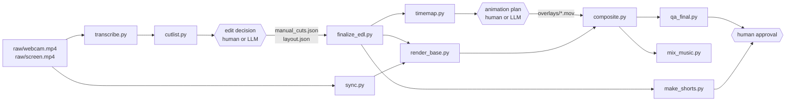

# Kurgu Hattı — talking-head + screen video edit pipeline

*Türkçe: [README.tr.md](README.tr.md)*

Turn a raw webcam recording and a screen recording into an edited YouTube video and vertical Shorts. You talk without worrying about the edit; the pipeline transcribes, syncs, removes silences and fillers, renders the face/screen layout, mixes audio, composites your animations and checks the result. A human approves before anything is published.

The scripts are plain Python + ffmpeg and run on their own. AI agents (any LLM) are optional: they fill in the decision files (what to cut, what to animate) that the scripts consume.

[](LICENSE)

## Features

- **Offline word-level transcription** with faster-whisper, with fillers encouraged into the transcript.
- **Audio-based sync** of webcam and screen recordings, piecewise (handles recorder drift/steps).
- **Automatic cut suggestions**: silences longer than 0.45 s are shortened, wordless voiced audio ≥ 0.40 s ("umm") is removed, emphatic repeats are kept, uncertain spots go to a review list. Never cuts inside a word.
- **Layout render**: TALK (face full frame, alternating punch-in at cuts) and SCREEN (screen full frame + round webcam PiP), smooth morph between them, zooms with keyframes.
- **Broadcast-style audio**: crossfade at every cut, cleanup chain, two-pass loudnorm to −14 LUFS / −1 dBTP (configurable).
- **Composite**: transparent overlay videos, intro/outro, SFX, ducked music, in one pass.
- **Shorts**: vertical re-framing from the raw sources with word-timed captions, hook/CTA, extra animation layer.
- **QA**: full decode, loudness, sync correlation and labelled contact sheets for visual review.
- **One settings file** for thresholds, loudness, quality and colors; language presets (`tr` tested, `en` starter).

## Architecture



| # | Station | Script / input | Output |
|---|---|---|---|
| 1 | Record | you | `raw/webcam.mp4`, `raw/screen.mp4` |
| 2 | Transcribe | `transcribe.py` | `work/transcript.json`, `.srt` |
| 3 | Sync | `sync.py` | `work/sync.json` |
| 4 | Auto cuts | `cutlist.py` | `work/edl.json` (cuts + review list) |
| 5 | Edit decision | human / LLM ([prompt](templates/prompts/edit-decision.md)) | `edit/manual_cuts.json`, `edit/layout.json` |
| 6 | Final EDL | `finalize_edl.py`, `timemap.py` | `edit/final_edl.json`, edited transcript, cut points |
| 7 | Base render | `render_base.py` | `renders/base.mp4` |
| 8 | Animation | your tool ([prompt](templates/prompts/animation-plan.md), [spec](templates/overlay-spec.md)) | `overlays/*.mov`, `edit/overlays.json` |
| 9 | Composite + QA | `composite.py`, `qa_final.py`, `mix_music.py` | `renders/final.mp4`, `qa/` |
| 10 | Shorts | `make_shorts.py` | `renders/shorts/` |
| 11 | Approve + publish | you | — |
| ↻ | Memory | [style guide](templates/style-guide.md) | every approved revision becomes a rule |

## Suggested division of labour

The pipeline does not depend on a specific AI. One setup that works well:

- **An LLM as editor** (e.g. Claude): reads the transcript and review list, writes `manual_cuts.json` / `layout.json`, plans animations, reviews contact sheets, turns revisions into style-guide rules.
- **A coding agent as operator** (e.g. Codex): runs the scripts, fixes paths, generates raster images.
- **A model or human as animator**: builds the overlays, e.g. with [HyperFrames](https://github.com/heygen-com/hyperframes) (HTML + GSAP → video) exported as transparent ProRes 4444.
- **A human**: records, gives feedback, approves.

Any step can be done by hand instead.

## Requirements

- Python 3.11+
- ffmpeg and ffprobe on `PATH` (libx264, ProRes, loudnorm, ebur128)
- A faster-whisper model downloaded locally (`large-v3` recommended); transcription never downloads
- Optional: NVIDIA GPU (Whisper on CUDA, NVENC encoding — falls back to CPU / libx264)
- Optional: an animation tool that exports transparent video (HyperFrames, After Effects, Motion Canvas, …)
- Optional: your own SFX (`sfx/library/`) and music (`music/`); none are included

## Installation

```bash
git clone https://github.com/barancaki/kurgu-hatti.git
cd kurgu-hatti
python -m venv .venv
source .venv/bin/activate        # Windows: .venv\Scripts\activate
pip install -r requirements.txt
```

Download a faster-whisper model once (for example into a Hugging Face cache folder such as `models/`) and pass it with `--model-root`.

## Quick start

Each video lives in its own folder; run commands from that folder. JSON paths are relative to it and nothing is ever written into `raw/`.

```
my-video/
  raw/        webcam.mp4, screen.mp4   (never modified)
  work/       transcript, sync, intermediates
  edit/       layout.json, manual_cuts.json, overlays.json, shorts.json, final_edl.json
  overlays/   rendered transparent MOVs
  renders/    outputs
  qa/         contact sheets and measurements
  kurgu.config.json                    (optional settings)
```

```bash
K=../kurgu-hatti/scripts            # this repo's scripts folder
cp ../kurgu-hatti/kurgu.config.example.json kurgu.config.json   # optional

# 1) audio + transcript
ffmpeg -i raw/webcam.mp4 -vn -ac 1 -ar 48000 work/webcam.wav
ffmpeg -i raw/screen.mp4 -vn -ac 1 -ar 48000 work/screen.wav
python $K/transcribe.py --audio work/webcam.wav --source-video raw/webcam.mp4 \
  --model-root models --output work/transcript.json --srt work/webcam.srt

# 2) sync webcam <-> screen
python $K/sync.py --webcam-audio work/webcam.wav --screen-audio work/screen.wav \
  --webcam-video raw/webcam.mp4 --screen-video raw/screen.mp4 \
  --output work/sync.json --verify-dir work/sync-verify

# 3) automatic cut suggestions
python $K/cutlist.py --transcript work/transcript.json --audio work/webcam.wav --output work/edl.json

# 4) edit decision: write edit/manual_cuts.json and edit/layout.json (see examples/)

# 5) final EDL + edited transcript
python $K/finalize_edl.py --edl work/edl.json --transcript work/transcript.json --audio work/webcam.wav \
  --manual-cuts edit/manual_cuts.json --output edit/final_edl.json
python $K/timemap.py --edl edit/final_edl.json --transcript work/transcript.json --export-dir edit

# 6) base render + QA
python $K/render_base.py --edl edit/final_edl.json --layout edit/layout.json \
  --output renders/base.mp4 --work-dir work/segments
python $K/qa_base.py --video renders/base.mp4 --edl edit/final_edl.json --layout edit/layout.json \
  --plan work/segments/render-plan.json --qa-dir qa

# 7) animations: build overlays/*.mov and edit/overlays.json

# 8) composite + final QA (+ optional music)
python $K/composite.py --input renders/base.mp4 --overlays edit/overlays.json \
  --output renders/final.mp4 --work-dir work/composite
python $K/qa_final.py --video renders/final.mp4 --base renders/base.mp4 --overlays edit/overlays.json \
  --plan work/segments/render-plan.json --manifest work/composite/composite-result.json --qa-dir qa/final
python $K/mix_music.py --input renders/final.mp4 --music music/bed.mp3 \
  --output renders/final-music.mp4 --work-dir work --intro 5 --outro 4

# 9) Shorts
python $K/make_shorts.py --config edit/shorts.json --plan-only
python $K/make_shorts.py --config edit/shorts.json

# after delivery: free disk space (dry-run first)
python $K/../tools/cleanup.py .
python $K/../tools/cleanup.py . --apply
```

Every script has `--help`. On Windows use Git Bash, or adapt the lines for PowerShell.

## Configuration

One JSON file holds the thresholds (silence 0.45 s, filler 0.40 s, padding), loudness (−14 LUFS, −1 dBTP), music levels, encoder quality, colors and the language lexicon. Pass it with `--config`, set `KURGU_CONFIG`, or put `kurgu.config.json` in the project folder. Per-video choices (layout, PiP size, zooms) stay in `edit/layout.json`. Details: [docs/configuration.md](docs/configuration.md).

## Documentation

- [Configuration](docs/configuration.md)
- [Base render and composite](docs/render-pipeline.md)
- [Music bed](docs/music-bed.md)
- [Vertical Shorts](docs/shorts-pipeline.md)
- Templates: [style guide](templates/style-guide.md), [animation plan](templates/overlay-spec.md), [Shorts plan](templates/shorts-spec.md), prompts for the [edit decision](templates/prompts/edit-decision.md) and the [animation plan](templates/prompts/animation-plan.md)
- Examples: [`examples/`](examples/) (illustrative values only)

## Tests

Offline checks that need no recording:

```bash
python scripts/check_analysis.py
python scripts/check_final_edit.py
python scripts/check_music.py
python scripts/make_shorts.py --self-check
python -m unittest discover -s tools -p "test_*.py"
```

`scripts/check_render.py` needs a real project (run in a project root with `raw/webcam.mp4` and `edit/*.json`).

## Limitations

- Tuned and tested on Turkish speech; the English lexicon is a starting point.
- Designed for 1920×1080 / 30 fps landscape and 1080×1920 vertical.
- Cut suggestions are conservative: anything uncertain is listed for review instead of being cut.

## Contributing

See [CONTRIBUTING.md](CONTRIBUTING.md).

## License

[MIT](LICENSE) © 2026 Baran Çakı
